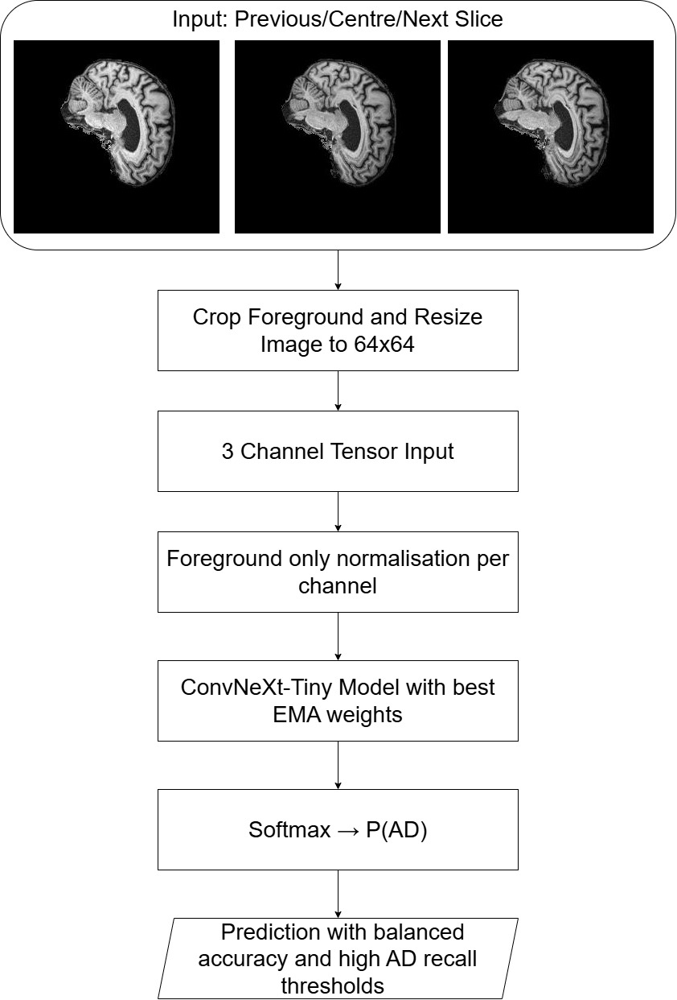
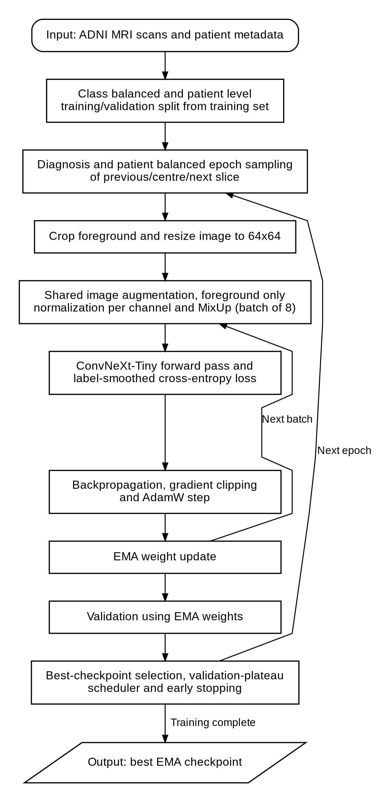
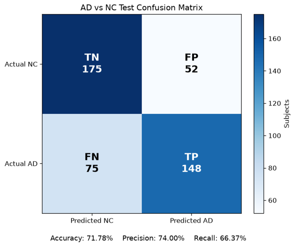
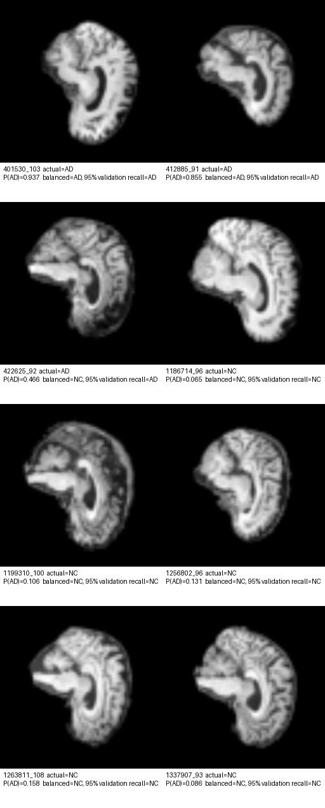
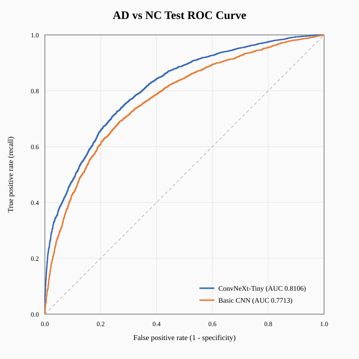
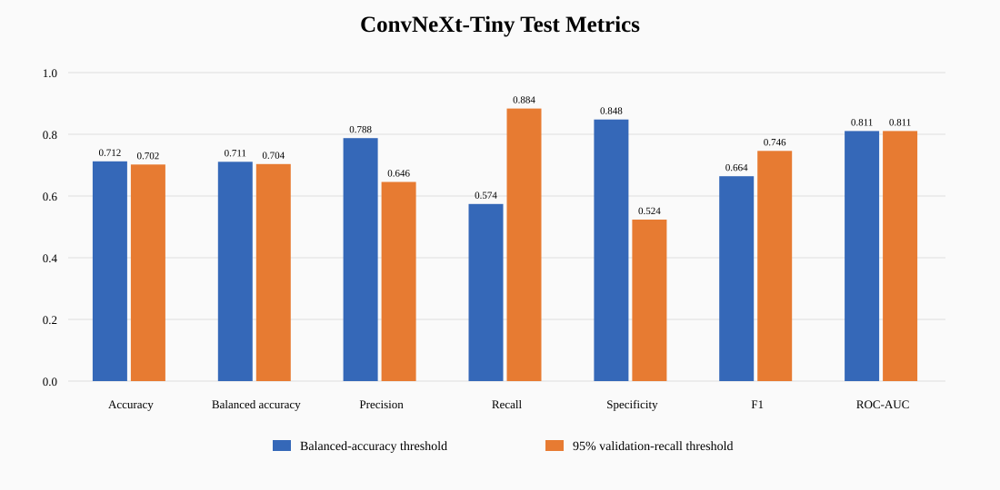
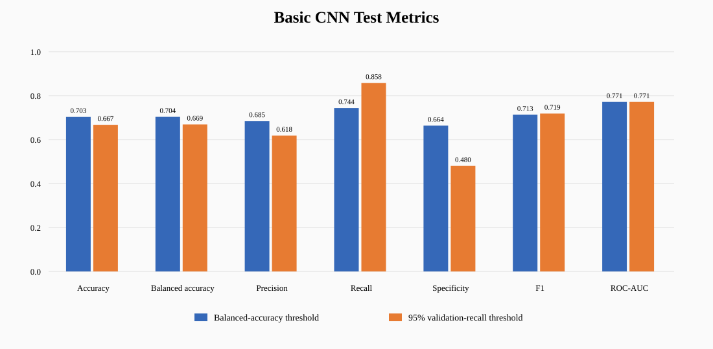
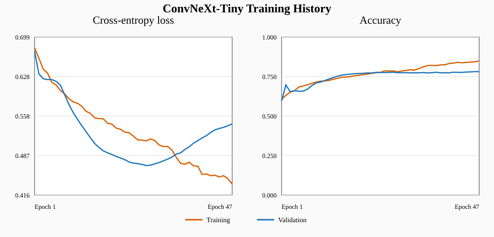
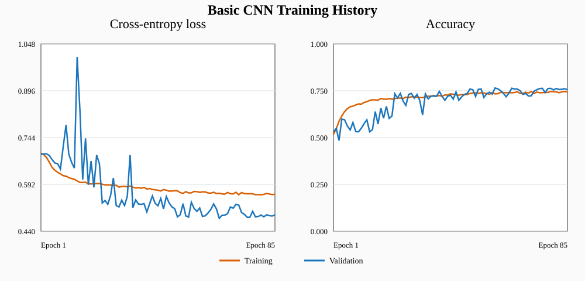
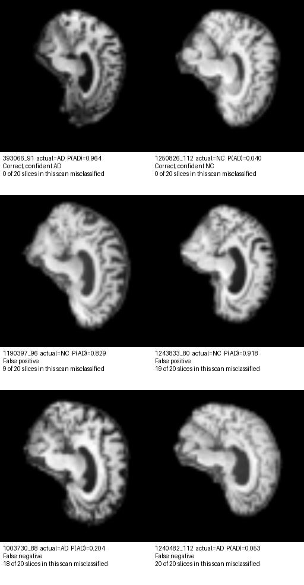

# Preparing a ConvNeXt Model for Neuroimaging, AD vs NC Classification

This project uses a layer-by-layer PyTorch implementation of ConvNeXt-Tiny to classify ADNI MRI slices as either Alzheimer's disease (AD) or normal cognition (NC).
The model uses a central slice and its left and right adjacent slices of an MRI scan as a 2.5D input into the model and follows the official TorchVision model architecture without using a prebuilt model or using pretrained weights. The code for the ConvNeXt-Tiny model layers was taken and adapted from the pytorch/vision repository at https://github.com/pytorch/vision/blob/main/torchvision/models/convnext.py. OpenAI's GPT-5.6 Sol (`gpt-5.6-sol`) was used as a prompting and coding assistant during development to help draft prompts, implement and debug code, and refine the project documentation.

The implementation foreground-centres and resizes each MRI slice, applies foreground only normalisation to each input channel separately and image augmentation that is shared between input channels, and uses patient separated training and validation data splits from the supplied training set with diagnosis and patient balanced sampling utilising the metadata. ConvNeXt-Tiny is trained from scratch in batches of eight using AdamW, label smoothing, stochastic depth, mixed precision, gradient clipping and MixUp, while exponential moving-average weights are used for validation, checkpoint selection and final inference. The learning rate uses linear warm-up followed by reductions on validation loss plateaus and early stopping. Validation results select both a balanced accuracy classification threshold and a high AD recall threshold before evaluation on the held-out test set.

The following figure shows the inference pipeline for a single MRI slice.



The following figure shows the training pipeline for a single MRI slice.



(Training pipeline figure generated with GPT-5.6 Sol)

## Dataset structure

The supplied ADNI data is organised as three nested levels: patients own scans, and scans own slices.
Each slice is a 256x240 grayscale JPEG named `<scan id>_<slice index>.jpeg`, so `218391_78.jpeg` is slice 78 of scan `218391`, and that scan contributes exactly 20 consecutive slices numbered 78 to 97.
`meta_data_with_label.json` maps each scan id to its originating patient, for example scan `932015` belongs to patient `068_S_0473`, which is the only way to tell that two differently numbered scans come from the same person.
The supplied training set holds 1,076 scans (21,520 slices) from 565 patients, and the held-out test set holds 450 scans (9,000 slices) from 331 patients, split into AD and NC folders.

## Written Feasibility Report

The following is the written feasibility report completed at the midpoint of the project on the 13/10/2026. It outlines the basic acceptance criteria of the project and core concepts for the ConvNeXt model.

It is important to note that the basic shallow CNN smoketest completed within this feasibility report utilised a different input and output architecture compared with the final model. This was that it was a scan-level classifier that made predictions based on the average of 12 slices from a scan, rather than a slice-level classifier that makes predictions based on a single slice and its adjacent slices like the final model. The change to the slice-level classifier was made afterwards, with the driving reason being that at the beginning of the project, the model had trouble learning the training data and was underfitting. I thought a reason for this was that the model did not have enough training samples to learn from and thus the scan-level sample size of 1,076 was increased to a slice-level sample size of 21,520.

### Feasibility Report: Preparing a ConvNeXt Model for Neuroimaging, AD vs NC Classification

#### 1. User Need Scope & Acceptance Criteria

- **User Scope:** The intended users are medical researchers or healthcare professionals who may use the model to assist them in diagnosing patients from the MRI scans.
- The prototype model will be used to determine if a ConvNeXt model is useful for the classification context, and if the heavier model provides value over a basic CNN classifier.
- **Acceptance Criteria:** Aim for 80% minimum test accuracy. Aim for high recall of at least 95%. Model can be trained within the hardware constraints set by the Rangpur HPC, peak VRAM < 40GB.

#### 2. Model Choice & Core Concepts

- Dataset configuration will be used with the originally provided train/test split. Training set will be divided into an 80/20 training/validation set using the validation performance to tune hyperparameters of the model. Final inference will then be run on the test set to determine the true performance of the model.
- ConvNeXt (Difficulty Band Hard) model architecture will be used. The driving reason for this is that they are known to match or outperform conventional CNNs. They use large depth wise kernels, wide hidden layers, and fewer activation functions to mimic the behaviour of a transformer.
  - This leads to the purpose of the research task being if this heavier model has an improvement over conventional CNNs for the AD vs NC application.
- It is recommended that the model would be used in conjunction with professional opinion as this is a safety critical application. As a result:
  - We **aim for high recall** as a misclassified AD would be detrimental to the patient.

#### 3. Preliminary Feasibility Evidence

- Dataset is provided as a separated training and test set with clear distinctions of patient numbers and MRI images in the format of &lt;patient_number&gt;\_&lt;image_number&gt;.
  - This can be used to ensure patient-level separation of the data.
- A smoke test with a shallow CNN was created to judge the effectiveness of a basic CNN model. The result was trained on my laptop on CPU, achieving a validation accuracy of 80% after 46 epochs completing training within the hour. Results are in the appendix.

#### 4. Risk Budget and Fallback

Risks include:

- Patient-level data leakage. It is important to ensure that during training the data is loaded correctly otherwise it is likely that the model will overfit on the train set, provide poor inference on the test set or produce incorrect metrics.
  - To mitigate this risk it is important to view results carefully.
- Training Risk: Training of the heavier ConvNeXt model may take a long time so it is important that adequate time is provided to train the model on the Rangpur HPC. Adequate time must be allocated for model training, inference, performance evaluation and interpretation of results within the project deadline.
  - If training is incomplete or the model performs poorly, the fallback is to still perform the evaluation and comparison to the basic CNN on the model that we ended up with.

#### Appendix, Smoke Test Results:



## Dependencies

The following table lists the project dependencies.

| Package | Version | Required | Used for |
| --- | --- | --- | --- |
| Python | 3.11.15 | yes | Language runtime, 3.10 minimum |
| PyTorch | 2.13.0 | yes | Deep learning framework: the model, training loop, data loading and GPU support |
| Pillow | 12.3.0 | yes | Image reading and writing |
| Matplotlib | 3.11.1 | optional | Result plots only |

Matplotlib is imported inside a `try`/`except ImportError` block in `save_training_curves`.
If it is missing, training still completes and every metric is still printed and written to `metrics.json`, but the plots are skipped.

### Hardware

The reported results were produced on a single NVIDIA A100 on the Rangpur HPC.

## Running the project

On the course cluster, submit the training experiment with:

```bash
sbatch train_convnext.sh
```

Weights, JSON metrics, confusion matrices and `training_curves.svg` are saved under `output/convnext_tiny_64px_2_5d_plateau`.
After training, example test predictions and a labelled image grid can be produced with:

```bash
python predict.py \
  --data-dir /home/groups/comp3710/ADNI/AD_NC \
  --metadata-path /home/groups/comp3710/ADNI/meta_data_with_label.json \
  --device cuda
```

To re-score the metrics of an existing checkpoint without training, add `--evaluate-only` to `train.py`.

## Reproducibility

Two seeds control the run, and both are recorded in `metrics.json` alongside the full configuration.

| Flag | Default | Controls |
| --- | --- | --- |
| `--seed` | `42` | the patient-level train/validation split only (`_patient_stratified_split`) |
| `--training-seed` | `123` | model initialization, epoch sampling order, augmentation, MixUp and DataLoader shuffling |

Scan `1012896` is excluded before splitting because its slices contain no usable foreground.

## Example inputs and outputs

Running `predict.py` samples eight random test slices and saves a labelled grid to `output/convnext_tiny_64px_2_5d_plateau/prediction_examples.png`.
An example is shown below.



Each panel shows the centre slice of one 2.5D input, after the foreground crop, the resize to 64x64 and per-channel foreground normalisation.
The previous and next slices occupy the other two channels and are not displayed.
Each caption gives the slice identifier, the true diagnosis, the predicted AD probability, and the decision taken at each of the two validation-selected operating points.

The eight slices are drawn with `torch.randperm` across all 9,000 test slices under `--example-seed`, so they come from eight different scans. Re-running the script reproduces the same selection.
This sample contains three AD slices and five NC slices, and seven of the eight are classified correctly at the validation set balanced-accuracy threshold of 0.6484.

## Data pre-processing and split justification

### Batch size

The model was originally trained with 224x224 inputs and a batch size of 48, but training accuracy plateaued at 66.14%, underfitting the training data.
A trial run with an input size of 64x64 and a batch size of 8 confirmed the model itself was not at fault, as it memorised eight real slices to 100% accuracy within a few updates. The input was then reduced to these parameters, and the full training run reached 100% training accuracy.
The most likely cause is the number of optimizer updates per epoch. A batch size of 48 gives about 359 updates, while batch 8 gives 2,118, so at the same learning rate the smaller batch makes roughly six times more progress per epoch.

### Pre-processing pipeline

Every example is a previous/centre/next slice input taken from one scan, and the pipeline below runs per example inside the data loader.

1. **Triplet construction.** The three channels hold the previous, centre and next slices of the same scan, with the label and prediction belonging to the centre slice. The first and last slices repeat their image to their neighbouring channel. Using adjacent slices as channels follows the pre-processing completed in an MRI classification study by Soelistiono S. ([adjacent-slice 2.5D MRI classification](https://pmc.ncbi.nlm.nih.gov/articles/PMC13085064/)).
2. **Foreground-centred crop.** Each 256x240 slice receives a constant 224x224 (the original ConvNeXt-Tiny input size) crop centred on the bounding box of its foreground. The crop size is fixed so differences in anatomical scale between patients are preserved.
3. **Resize to 64x64.** The crop is resized bilinearly to 64x64. This was done after the aforementioned smaller input and batch size trial run. A run with 96x96 inputs was later completed, but it generalised worse than 64x64. A reasoning behind this is that larger input images contain fine scanner-specific texture that is not relevant to the diagnosis, and the smaller input removes that texture, and widens the model's receptive field relative to the brain.
4. **Training augmentation.** Training examples receive a random affine warp (rotation +/-7 degrees, translation +/-5%, scale +/-5%) followed by gamma jitter (+/-20%), contrast and gain jitter (+/-10% each) and additive Gaussian noise with standard deviation 0.01. These transforms are shared across the three channels so that the 2.5D context remains consistent. There is deliberately no flipping, since all the scans within the dataset share orientation.
5. **Foreground-only normalisation.** Each channel is standardised independently using the mean and standard deviation of its own foreground pixels, and background pixels are forced to exactly zero. This removes intensity variation that MRI acquisition introduces between slices.
6. **MixUp.** Batches are mixed on the GPU after normalisation using a mixing weight drawn from a Beta(0.4, 0.4) distribution, with one weight shared by the whole batch, and the loss is the matching weighted combination of the two label assignments ([MixUp](https://openreview.net/pdf?id=r1Ddp1-Rb)).

Validation and test pre-processing consists of steps 1, 2, 3 and 5 only.

### Regularisation and training-time techniques

Most of these settings are taken from Table 5 in Appendix A.1 of [A ConvNet for the 2020s](https://arxiv.org/abs/2201.03545), which lists the ImageNet-1K training recipe, and several are used at exactly the published value.
The rest are changed or dropped because this project trains from scratch on 21,500 MRI slices rather than 1.28 million natural images.
The source column below says where each value came from.

| Technique | Setting | Source | Purpose |
| --- | --- | --- | --- |
| Stochastic depth | 0.1, scaled linearly with block depth | Paper Table 5, 0.1 for ConvNeXt-T | Drops whole residual branches, strongest in the deepest blocks |
| Label smoothing | 0.1 | Paper Table 5, unchanged | Prevents over-confident logits on noisy slice-level labels |
| Weight decay | 0.05 (AdamW) | Paper Table 5, unchanged | Constrains weight magnitude on a small dataset |
| Layer scale | 1e-6 initial | Paper Table 5, unchanged | Keeps residual branches near-identity early in training |
| EMA | decay 0.9999 | Paper Table 5, unchanged | Averaged weights used for validation, checkpoint selection and all final inference |
| Weight init | truncated normal, std 0.02 | TorchVision ConvNeXt source | Matches the reference implementation |
| MixUp | alpha 0.4 | Reduced from the paper's 0.8 | Discourages memorisation of correlated slices |
| Dropout | none | Paper Table 5 uses none | Stochastic depth and MixUp regularise instead |
| RandAugment, CutMix, random erasing | not used | Dropped from the paper recipe | All three are designed for natural images and would destroy or mislabel anatomy |
| Gradient clipping | global norm 1.0 | Added, the paper lists "None" | Caps rare large updates at batch size 8 |
| Mixed precision | bfloat16 autocast | Optional `--use_amp` in the [training recipe](https://github.com/facebookresearch/ConvNeXt/blob/main/TRAINING.md), dtype chosen here | fix for the non-finite losses that float16 produced |

### Learning rate schedule, warm-up and early stopping

The learning rate uses a linear warm-up followed by reduction on validation loss plateaus, and training is terminated by early stopping.

**Warm-up.** The first five epochs ramp the learning rate linearly from `2e-5` to the base rate of `1e-4` in equal steps.
A randomly initialised network produces large gradients in its first few hundred updates. Applying the larger base learning rate immediately risks divergence.
The ConvNeXt recipe uses 20 warm-up epochs for a 300-epoch ImageNet schedule, and five was chosen here as a proportion of a much shorter run.

**Plateau reductions.** After warm-up the rate is controlled by `ReduceLROnPlateau` watching validation loss, with factor `0.5`, patience `5`, an absolute improvement threshold of `1e-4` and a floor of `1e-6`.
The rate is halved when validation loss has failed to improve for five consecutive epochs.

**Early stopping.** Training stops once validation loss has gone 20 consecutive epochs without improving by at least `1e-4`, and counting does not begin until after epoch 10 so that the warm-up and initial learning phase cannot end the run prematurely. This is done to reduce unnecessary training time, since the model is already overfitting the training data.
The maximum budget is 100 epochs, and the final run used 47 of them.

**Checkpointing on loss rather than accuracy.** The saved weights checkpoint is the one with the lowest validation loss, not the one with the highest validation accuracy. This is because loss is sensitive to how confident each prediction is.

### Data Split

**Testing.** The ADNI data arrives already divided into `train` and `test` directories, and is used unchanged. The test set is not used in training, model selection or threshold selection, and both thresholds are chosen on validation data and then applied to it unchanged.

**Training and validation.** The supplied training set is divided 80/20 into training and validation. The split is made by patient, not by scan or by slice, and it is divided by diagnosis so that 20% of the AD patients and 20% of the NC patients are held out independently.

Earlier trial runs contained no repeated scans or images and still leaked. This was because the metadata was not considered, which showed 109 patients with different scans on both sides of the split. The leakage was class-skewed, with 95 of 101 validation AD scans coming from patients seen during training compared with only 104 of 223 test AD scans. The consequence was a validation accuracy of 88.70% against a test accuracy of 72.66% with 57.22% AD recall, so validation was not truly measuring generalisation to unseen patients.

**Balanced epoch sampling.** Splitting by patient still leaves unbalanced batches, because AD patients have far more scans each than NC patients (3.36 against 1.32 in the training split).
Sampling slices at random would therefore let a handful of heavily scanned AD patients dominate their own class.
Each epoch instead draws an equal number of slices per diagnosis, then an equal number per patient within each diagnosis.

## Quantitative benchmarking against the baseline

The shallow CNN in `basic_cnn/` is run through the same `train.py` pipeline as ConvNeXt. This CNN differs from the smoke-test basic CNN, which was a scan-level model that averaged the features of 12 slices into a single prediction per scan. The baseline used here keeps the same model but removes that averaging, so it takes the same 2.5D triplet input and returns one prediction per centre slice, exactly as ConvNeXt does. ConvNeXt-Tiny has 27,821,666 parameters against 14,114.

### Test set results

| Metric | ConvNeXt-Tiny | Basic CNN | Difference |
| --- | ---: | ---: | ---: |
| Accuracy | 71.22% | 70.34% | +0.88 |
| Balanced accuracy | 71.10% | 70.38% | +0.72 |
| Precision | 78.77% | 68.48% | +10.29 |
| Recall | 57.40% | 74.39% | -16.99 |
| Specificity | 84.80% | 66.37% | +18.43 |
| F1 | 66.41% | 71.32% | -4.91 |
| ROC-AUC | 0.8107 | 0.7714 | +0.0393 |
| Validation accuracy | 78.71% | 75.94% | +2.77 |

Between the two models, both stopped training due to early-stopping and ended up with similar accuracy, with the baseline even performing better on recall and F1.
The main difference between the two is the ROC-AUC, which is the area under the curve shown below.
Unlike every other metric in the table it does not depend on the chosen threshold, and it is the probability that a random AD slice is scored higher than a random NC slice with 81.1% for ConvNeXt against 77.1% for the baseline.



Looking at the ROC curves, ConvNeXt lies above the baseline at essentially every threshold, so it offers more recall than the baseline at any threshold a deployment might choose.




### Overfitting and model capacity

The training curves show the clearest difference between the two models.

| | ConvNeXt-Tiny | Basic CNN |
| --- | ---: | ---: |
| Epochs run (early stopped) | 47 | 85 |
| Best epoch | 27 | 65 |
| Training accuracy at best epoch | 78.6% | 73.9% |
| Training accuracy at final epoch | 85.0% | 74.3% |
| Validation loss, best to final | 0.4690 to 0.5436 | 0.4821 to 0.4933 |

After its best epoch ConvNeXt kept fitting the training split, gaining 6.4 points of training accuracy while validation loss degraded by 0.075 and accuracy stagnated.
The shallow CNN gained 0.4 points over its final 20 epochs and its validation loss barely moved, because at 14,114 parameters it does not have the capacity to memorise 16,940 slices.
Earlier ConvNeXt runs make the same point. Before the full regularisation set was added, the 64x64 run reached 100% training accuracy with 80.53% validation accuracy, memorising the training split outright while generalising no better than the current run does. Stochastic depth, label smoothing, MixUp and weight decay are what kept the final run at 85% training accuracy rather than 100%.




### Splitting predictions by confidence

Because ConvNeXt's probabilities are more trustworthy, its two thresholds can be used to split the test slices into three groups instead of forcing a single AD or NC answer on every slice.
The figures in this section are produced by `analyse_predictions.py`, which reads the per-slice probabilities saved during evaluation.

| Group | Rule | Slices | Share | How often it is right |
| --- | --- | ---: | ---: | ---: |
| Very likely AD | P(AD) at or above 0.648 | 3,250 | 36.1% | 78.8% |
| Needs a specialist to look | between 0.172 and 0.648 | 2,854 | 31.7% | not answered |
| Very likely NC | P(AD) below 0.172 | 2,896 | 32.2% | 82.1% |

The two outer groups cover 68.3% of the test set and ConvNeXt gets 80.3% of them right, compared with 71.2% when it is forced to label every slice.
Handing the middle group to a specialist is therefore worth 9.1 points of accuracy on everything that is left.

The basic CNN can be split the same way, but it gains very little from it.
Its two thresholds sit close together at 0.254 and 0.381, so only 14.9% of slices fall in the middle group, and its accuracy on the rest is 71.8% against 70.3% overall, a gain of 1.4 points instead of 9.1.

Both models label slices about equally well, but ConvNeXt can also tell which of its own answers are unreliable.

## Resource profiling

Resources were measured on the course cluster with `profile_resources.py`, over 100 iterations after 20 warm-up iterations.
It measures the forward pass only and excludes image decoding and pre-processing.

| Model | GPU | Precision | Input | Batch | Parameters | Peak allocated VRAM | Peak reserved VRAM | Batch latency | Per-slice latency | Throughput |
|---|---|---|---:|---:|---:|---:|---:|---:|---:|---:|
| ConvNeXt-Tiny | NVIDIA A100-PCIE-40GB | bfloat16 | 64x64x3 | 8 | 27,821,666 | 121.16 MiB | 152.00 MiB | 6.474 ms | 0.809 ms | 1235.63 slices/s |

At 0.809 ms per slice the whole 9,000-slice test set takes about 7.3 seconds of GPU compute, and a complete 20-slice scan is classified in roughly 16 ms.
Peak allocated memory of 121 MiB is a tiny fraction of the A100's 40 GB, which confirms that batch size 8 was an optimisation choice rather than a memory limit.

## Failure case analysis

Six test slices are shown below, all evaluated at the balanced-accuracy threshold of 0.648.
The top row is the model at its most confident and correct, and is included so the four failures beneath it can be compared against what a clear case looks like.



| Slice | Truth | P(AD) | Outcome | Slices wrong in that scan |
| --- | --- | ---: | --- | ---: |
| `393066_91` | AD | 0.964 | Correct | 0 of 20 |
| `1250826_112` | NC | 0.040 | Correct | 0 of 20 |
| `1190397_96` | NC | 0.829 | False positive | 9 of 20 |
| `1243833_80` | NC | 0.918 | False positive | 19 of 20 |
| `1003730_88` | AD | 0.204 | False negative | 18 of 20 |
| `1240482_112` | AD | 0.053 | False negative | 20 of 20 |

Comparing the rows visually, the confident AD scan shows obvious large dark spots while the confident NC scan looks full. To my eye, the example false positives resemble the AD example more than the NC one.

The last column shows these are not isolated bad slices of scans. When the model fails to predict a slice, it will likely fail to predict all the slices from the same scan. Thus the biggest failure mode of the model is at the scan level.

## Engineering recommendation and trade-off synthesis

### Recommendation

**Use the model to sort slices into the three groups above rather than to label every slice.**
Its two thresholds already separate very likely AD and very likely NC from a middle group it cannot call, and answering only the two outer groups covers 68.3% of slices at 80.3% accuracy against 71.2% when it is forced to label everything.
Adding this step would allow the model to reach the project's 80% target. The gain over the basic CNN is that its better-separated confidence scores make declining uncertain predictions worthwhile.

### Tradeoffs

**The recall target did not transfer from validation to test.**
The high-sensitivity threshold was selected to reach at least 95% AD recall on validation and delivered 95.0% there, but only 88.4% on the test set.

**519 AD slices land in the very likely NC group.**

### Next Steps

- **Run the missing 224x224 input batch-8 trial run.** This would determine whether the batch size or the input resolution removed the training plateau, which would indicate which hyperparameters could still be changed to improve performance. This was not done as time on the Rangpur HPC was limited.
- **Evaluate ImageNet-pretrained initialisation.** Pre-trained weights were deliberately avoided in this project, but since they were never tested, using them may still yield better results.
- **Collect more patients rather than more slices.** ConvNeXt-Tiny has 27.8 million parameters, but the training and validation data comes from only 564 patients and 1,075 scans, so the model has far more parameters than it has examples to learn from. The failure analysis shows that all twenty slices of a scan are very often predicted similarly, so only more scans from more patients would meaningfully enlarge the dataset. This would be the most expensive option but also the one most likely to increase generalisation.

## Artificial Intelligence Usage Disclosure

OpenAI's GPT-5.6 Sol (`gpt-5.6-sol`) was used throughout this project as a coding and writing assistant.

**What it assisted with.**
It was used to help develop and debug code, to locate and compare reference implementations of ConvNeXt so that the layer-by-layer version in `modules.py` could be written against the original paper and the TorchVision source, and to help work through errors during training and evaluation.
It was also used to help organise the findings of the project and to draft and edit this `README.md`.

**How its output was verified.**
Suggested code was read through before being used, and every metric was checked against the expected behaviour of the model. The ConvNeXt implementation was checked against the TorchVision source.
Results that looked wrong were investigated.
The clearest example is the gap between validation and test accuracy. During development, an iteration of the model caused the validation accuracy to reach 88.70% while the test set reached only 72.66% with 57.22% AD recall, so I checked the patient metadata and found 109 patients with scans on both sides of the split.
That is what led to the diagnosis-stratified, patient-grouped split used throughout the project, documented earlier within the report.

## References

- [A ConvNet for the 2020s](https://arxiv.org/abs/2201.03545)
- [TorchVision ConvNeXt source](https://github.com/pytorch/vision/blob/main/torchvision/models/convnext.py)
- [Official ConvNeXt training recipe](https://github.com/facebookresearch/ConvNeXt/blob/main/TRAINING.md)
- [MixUp](https://openreview.net/pdf?id=r1Ddp1-Rb)
- [Adjacent-slice 2.5D MRI classification](https://pmc.ncbi.nlm.nih.gov/articles/PMC13085064/)
